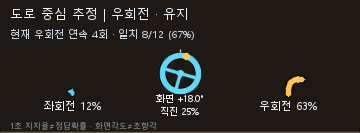

# Drivable Area Estimation

TwinLiteNet+의 차선 마스크와 SegFormer의 도로 마스크를 이용해 **차로/도로 중심 경로**, **직진·좌회전·우회전 추정**, **최근 검출 가중치 화살표**를 영상에 표시합니다.

기본 화면은 상단 소형 UI입니다. 화살표 길이는 최근 1초의 검출 지지율을 나타내고, 연속 검출·가중치·방향 간 차이를 함께 확인한 뒤 표시 방향을 바꿉니다. 중간 광류 추적 프레임은 새 검출 횟수로 세지 않습니다.

가운데 스티어링 휠은 **화면 기준 방향각**에 따라 부드럽게 회전합니다. 음수는 왼쪽, 양수는 오른쪽이며 실제 차량의 조향각을 뜻하지 않습니다. 방향 전환 확인 중에는 반대 방향의 단발성 검출로 휠을 바꾸지 않고, 관측이 만료되면 회전량을 대기로 표시합니다.



> 도로 마스크는 현재 차로의 정답이 아닙니다. 차선과 최근 차로 이력이 부족한 구간은 `도로 중심 추정`으로 표시합니다. 가중치는 정답 확률이 아니며, 화면 각도는 실제 조향각이 아닙니다.

## 빠른 시작 — Windows / Python 3.11

```powershell
git clone https://github.com/smhotkdg/drivable-area-estimation.git
cd drivable-area-estimation
py -3.11 -m venv .venv
.\.venv\Scripts\python.exe -m pip install --upgrade pip
.\.venv\Scripts\python.exe -m pip install torch --index-url https://download.pytorch.org/whl/cpu
.\.venv\Scripts\python.exe -m pip install -e ".[inference]"
```

FFmpeg를 설치하고 `ffmpeg -version`이 실행되는지 확인하세요. [설치 안내](docs/SETUP.md)와 [가중치 준비](weights/README.md)를 따라 `weights/small.pth`를 준비합니다. SegFormer는 첫 추론 시 모델 저장소에서 다운로드됩니다.

```powershell
.\.venv\Scripts\python.exe -m drivable_area video --config configs/default.toml --source "C:\videos\FMA_Test.MOV" --output outputs/result.mp4
```

기본값은 **전체 길이**, **원본 평균 FPS**, **높이 640px**, **5프레임마다 검출**, **상단 화살표 UI**입니다. 원본 종횡비를 유지하며 세로 1080×1920 영상은 360×640으로 저장됩니다. 결과는 H.264 MP4와 프레임별 진단 JSON입니다. 프레임 이미지를 결과 폴더에 저장하지 않습니다.

짧게 확인하려면:

```powershell
.\.venv\Scripts\python.exe -m drivable_area video --source "C:\videos\FMA_Test.MOV" --output outputs/preview.mp4 --start-seconds 80 --duration 8
```

## 기존 마스크로 빠르게 재실행

기존에 검출한 `segformer_masks/`, `lane_masks/`가 있으면 모델 가중치나 PyTorch 없이 실행할 수 있습니다. 캐시와 원본 영상은 반드시 같은 프레임 순서여야 합니다.

```powershell
.\.venv\Scripts\python.exe -m pip install -e .
.\.venv\Scripts\python.exe -m drivable_area video --source "C:\videos\FMA_Test.MOV" --cache-dir "C:\mask-cache\FMA_Test" --output outputs/cached.mp4
```

```text
FMA_Test/
  segformer_masks/frame_000001.png  # 0: 배경, 255: 도로
  lane_masks/frame_000001.png       # 0: 배경, 255: 차선
```

프레임 번호는 **1부터 시작**합니다. 누락된 캐시는 오류로 보고하며 다른 영상의 마스크로 대체하지 않습니다.

## UI만 다시 만들기

경로 생성 때 저장한 JSON과 대응하는 영상을 사용합니다. UI가 없는 결과에 적용하는 것이 좋습니다. 이미 큰 UI가 덮인 영상의 원래 픽셀을 복원하지는 않습니다.

```powershell
.\.venv\Scripts\python.exe -m drivable_area arrows --config configs/default.toml --input outputs/cached.mp4 --metadata outputs/cached.json --output outputs/arrows.mp4
```

새 명령 `road-area video ...`, `road-area arrows ...`도 제공합니다. 기존 명령 이름을 위한 `track_road_video.py`, `add_direction_arrows.py`는 얇은 호환 진입점입니다.

## 어디를 수정하면 되나요?

| 수정할 내용 | 파일/폴더 |
|---|---|
| 기본 해상도·검출 주기·방향 전환 기준 | [`configs/default.toml`](configs/default.toml) |
| 설정 필드·범위 검사 | [`config.py`](src/drivable_area/config.py) |
| 도로 영역과 차로 경계 처리 | [`geometry/`](src/drivable_area/geometry/) |
| 차로 폭 유지·중심 경로 | [`single_lane_center.py`](src/drivable_area/geometry/single_lane_center.py) |
| 광류·경로 추적 | [`path_tracker.py`](src/drivable_area/tracking/path_tracker.py) |
| 좌·직진·우 판단과 최근 검출 투표 | [`tracking/`](src/drivable_area/tracking/) |
| 화살표·색상·글자·상단 배치 | [`dashboard.py`](src/drivable_area/visualization/dashboard.py) |
| 스티어링 표시의 보간·유효 기간 | [`steering_indicator.py`](src/drivable_area/tracking/steering_indicator.py) |
| 스티어링 휠 그림 | [`steering_wheel.py`](src/drivable_area/visualization/steering_wheel.py) |
| TwinLiteNet+/SegFormer 추론 | [`models/segmentation.py`](src/drivable_area/models/segmentation.py) |

CLI 인수가 설정 파일보다 우선합니다. 개인 경로는 `configs/local.toml`에 넣으세요. 이 파일과 가중치·영상·출력·캐시는 Git에서 제외됩니다.

- [설치와 실행](docs/SETUP.md)
- [구조와 데이터 흐름](docs/ARCHITECTURE.md)
- [수정·회귀 검사 방법](docs/DEVELOPMENT.md)
- [현재 검증 범위와 한계](docs/VALIDATION.md)
- [외부 코드·모델 출처와 라이선스](docs/THIRD_PARTY.md)

## 테스트

```powershell
.\.venv\Scripts\python.exe -m pip install -e ".[dev]"
.\.venv\Scripts\python.exe -m unittest discover -s tests -v
.\.venv\Scripts\ruff.exe check src tests
.\.venv\Scripts\ruff.exe format --check src tests
```

GitHub Actions는 모델 다운로드 없이 핵심 테스트와 합성 영상 처리·UI 재생성 검사를 실행합니다.

## 라이선스

이 저장소의 코드에는 [MIT 라이선스](LICENSE)를 적용하며, 포함한 TwinLiteNet+ 코드의 저작권 고지를 유지합니다. SegFormer 모델은 [모델 카드](https://huggingface.co/nvidia/segformer-b0-finetuned-cityscapes-1024-1024)가 안내하는 [별도 라이선스](https://github.com/NVlabs/SegFormer/blob/master/LICENSE)를 따릅니다. 가중치와 원본 영상은 배포하지 않습니다.
