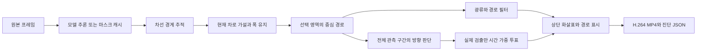

# 구조와 데이터 흐름



## 모듈 경계

```text
src/drivable_area/
  cli.py                 # video / arrows 진입점
  config.py              # dataclass 설정, TOML, 검증
  pipeline.py            # 영상 읽기와 단계 연결
  replay.py              # 저장한 evidence로 UI만 재생성
  video_io.py            # FFmpeg 출력
  models/                # 선택 설치한 PyTorch/Transformers 추론
  geometry/              # 경계, 차로 선택, 중심선, 비교용 기존 방식
  tracking/              # 광류/Kalman 경로, 방향 판단, 검출 투표
  visualization/         # 원본·경로 렌더링, 상단 한글 화살표
  _vendor/twinlitenet/    # 원본 모델 구조와 전처리, 원본 라이선스
```

## 기본 실행 경로

`lane-center`가 기본입니다. `medial`, `continuation`, `boundaries`는 이전 결과와 비교하기 위한 경로이며 기본 기능을 대신하지 않습니다.

검출 프레임에서만 모델/캐시를 읽습니다. 나머지 프레임은 광류와 추적 상태를 사용합니다. 차선 경계, 경로 필터, 방향 판단은 상태를 분리해 경로 필터의 일시적인 충돌이 모든 방향 정보를 없애지 않도록 했습니다.

`SingleLaneTracker`는 최근 관측한 경계 쌍과 폭을 기억하고 갑작스러운 확장을 제한합니다. 유효 기간이 지난 차로를 무기한 유지하지 않습니다. 근거가 없으면 `road_center_estimate`로 되돌아가며, 넓은 도로를 임의로 반으로 나누지 않습니다.

## 중심선과 방향의 관측 거리

표시 경로는 영상 높이의 0.70배 호 길이를 기본 상한으로 사용합니다. 방향 판단은 가능한 전체 관측 중심선을 사용합니다. 표시 경로가 짧다고 먼 곡선까지 직진으로 잘못 간주하는 문제를 줄이기 위한 분리입니다. 마스크 밖의 끝부분은 잘라내고 연결된 유효 구간만 사용합니다.

## 투표와 수치의 의미

- 최근 1초의 검출을 보관합니다.
- 반감기 0.35초로 최근 검출에 더 큰 가중치를 부여합니다.
- 연속 3회, 후보 지지율 0.60 이상, 다른 방향과의 차이 0.20 이상일 때 전환합니다.
- 0.5초 이상 유효 검출이 없으면 이전 방향을 만료합니다.
- 화살표 길이만 추가로 완만하게 보간합니다. 표시 보간값으로 방향 전환을 판정하지 않습니다.
- 연속 횟수는 검출 이벤트 수입니다. 예측 프레임 수가 아닙니다.

가중치는 유효 방향 검출 사이의 상대 지지율입니다. 최근 일치율의 분모에는 알 수 없음 관측도 포함합니다. 시간적으로 인접한 검출은 서로 상관될 수 있으므로, 이를 통계적으로 독립인 표본이나 정답 확률로 해석하지 않습니다.
